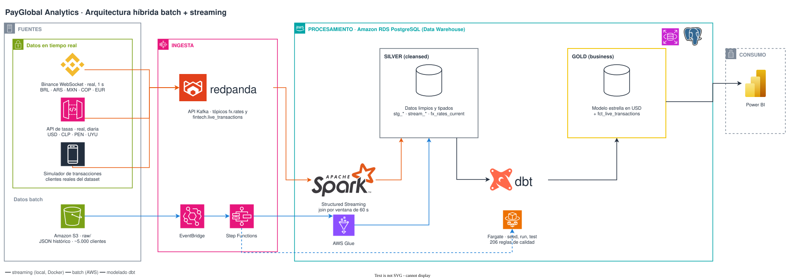
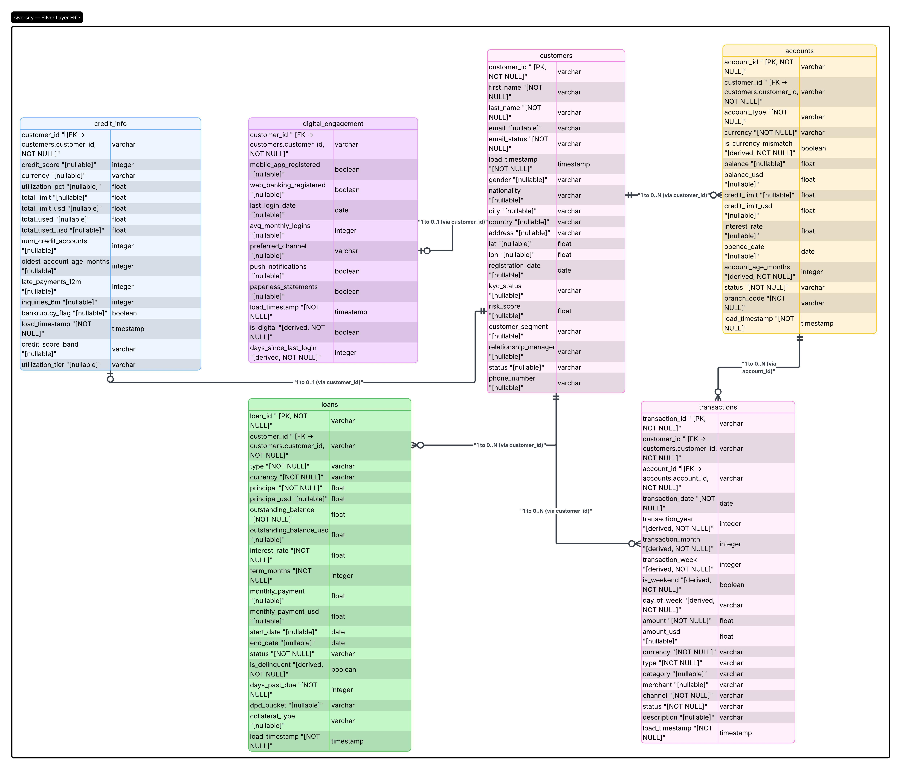
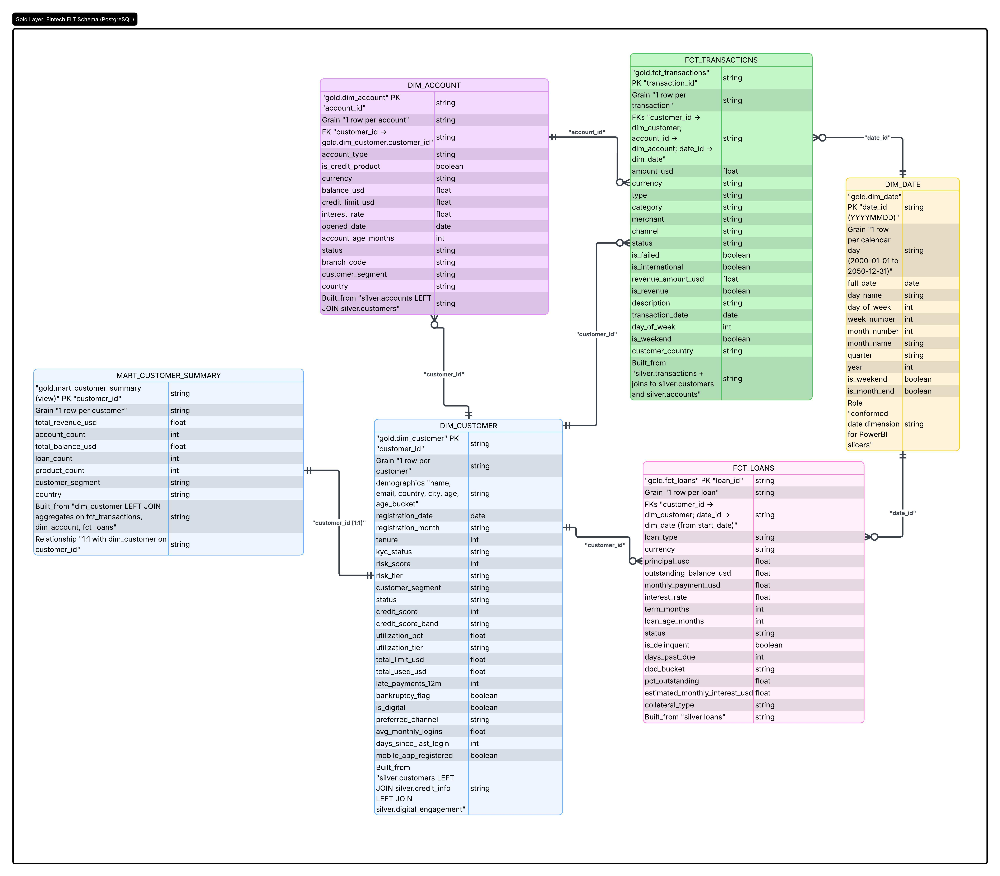
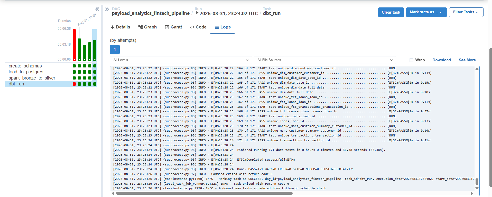

# Payload Analytics

A hybrid data platform for a LATAM fintech that operates in seven markets. Two speeds of data meet in one PostgreSQL warehouse:

- **Batch:** a JSON file of ~5,000 customers, with their accounts, transactions, and loans, is dropped in S3. It is flattened with Spark on Glue, then cleaned and modeled with dbt on Fargate.
- **Streaming:** real market FX rates and live transactions flow through Redpanda (Kafka) into Spark Structured Streaming, which joins each transaction with the rate in effect when it happened.

dbt converts every amount to USD with the live rate. That is where the two speeds meet, and Gold is left ready for reporting.

## Architecture



| Piece | Where | Role |
| --- | --- | --- |
| S3 data lake | AWS | Bronze for batch. `raw/` is the inbox, `processed/` is the archive, `failed/` keeps files that did not finish. |
| EventBridge + Step Functions | AWS | A new object in `raw/` starts the state machine: Glue, then dbt, then it moves the file. |
| Glue | AWS | Reads one JSON file from S3 and replaces the four `silver.stg_*` tables. |
| Fargate | AWS | Runs `dbt seed`, `dbt run`, and `dbt test` from a container image in ECR. |
| RDS PostgreSQL | AWS | Warehouse: Silver staging, streaming Silver, cleaned Silver, seeds, and Gold. |
| SNS | AWS | Emails the team when a run fails. |
| Secrets Manager | AWS | The only place the database password lives. Glue, Fargate, and the streaming job read it from there. |
| Redpanda | Local | Kafka-compatible broker. Its two topics are the raw event log, the Bronze of the streaming side. |
| FX producers | Local | Real rates: Binance trades for five currencies, a daily API for the other four. Each currency has one source. |
| Transaction simulator | Local | Live transactions on real customers and accounts from the dataset, with the source's dirt kept. |
| Spark Structured Streaming | Local | Joins each transaction with the latest FX tick of the minute before it, then upserts `silver.stream_*` on RDS. |
| dbt `fx_rates_current` | RDS | The latest live rate per currency, or `seed_fx_rates` when the stream has no recent tick. Every USD amount in Silver and Gold uses it. |

**Why hybrid.** The streaming side runs in Docker on a laptop and writes to the same RDS as the batch. A managed Kafka (MSK) costs USD 70–500 a month, and Kinesis plus a Glue streaming job about USD 1 per hour while running; the team's budget alert is USD 1 a month. Running it locally keeps the AWS bill at the batch's cost, and nothing downstream changes: dbt reads `silver.stream_*` like any other table.

There is no NAT Gateway. The database is a public `db.t4g.micro` in the default VPC. Glue uses AWS's managed network. The dbt task runs in the default public subnets with a public IP so it can pull its image, read the database secret, and reach PostgreSQL.

Each new file replaces `silver.stg_*` and dbt rebuilds the tables on top. Two uploads close together do not run at once: Glue allows one run, and Step Functions waits and retries.

## Layers

- **Bronze** is the JSON object in S3 for batch, with nested accounts, transactions, loans, credit info, and digital engagement intact. For streaming it is the Redpanda topics, which keep every event as it was published.
- **Silver staging** (`silver.stg_*`) is the flattened Spark output: customers, accounts, transactions, and loans. Values stay strings. Credit info and digital engagement stay JSON text on the customer row.
- **Silver streaming** (`silver.stream_fx_rates`, `silver.stream_transactions`) is what Spark Structured Streaming writes: every FX tick, and every live transaction with the rate joined at event time. Business fields stay strings; event times are typed so latency can be measured.
- **Silver** is the dbt layer: typed amounts, parsed dates, seed lookups, flags for bad emails and currency mismatches, `fx_rates_current`, and the cleaned live transactions.
- **Gold** is the star schema for reporting: customer, account, and date dimensions, transaction and loan facts, a customer summary, and `fct_live_transactions`, the incremental fact of the stream.

The diagrams below show the batch models. The streaming models and every dependency between tables are in the [lineage](docs/governance/lineage.md) and the [data catalog](docs/governance/catalog.html).





## Project layout

```text
payload-analytics/
├── .docker/                         # Image used by both dev containers
├── .envs/                           # AWS credentials and the Serverless key (not committed)
├── infrastructure/                  # S3, RDS, ECR, alerts
│   └── serverless/
│       ├── storage/
│       ├── rds/
│       ├── registry/
│       └── alerts/
├── backend/
│   ├── database/rds/                # SQL migration for silver.stg_*
│   ├── src/spark/                   # Glue job and shared transforms
│   ├── src/dbt/                     # dbt project and its image
│   └── serverless/
│       ├── spark/
│       ├── dbt/
│       └── orchestration/
├── streaming/                       # Local Redpanda and producers (runs on your machine)
│   ├── .docker/
│   └── src/producers/
├── docs/
│   ├── governance/                  # Data dictionary, catalog, lineage, quality rules, RACI
│   └── optimizations/               # Index experiments with EXPLAIN before and after
└── data/raw/                        # Sample JSON used to start a run
```

## Before you start

- Docker Desktop running
- An AWS account, with permission to create S3, RDS, ECR, Glue, ECS, Step Functions, SNS, and IAM
- A Serverless Framework access key

Nothing else is installed on the host. Serverless, the AWS CLI, and Docker (for the dbt image) run inside the dev containers.

## 1. Fill in the environment files

These files are gitignored. Create them if they are missing.

`.envs/aws.env`

```text
AWS_ACCESS_KEY_ID=
AWS_SECRET_ACCESS_KEY=
AWS_DEFAULT_REGION=us-east-2
AWS_DEFAULT_OUTPUT=json
```

`.envs/sls.env`

```text
SERVERLESS_ACCESS_KEY=
```

`infrastructure/.envs/config.env` and `backend/.envs/config.env` share the developer name and the VPC. `ALERTS_EMAIL` is only on the infrastructure file. `DEVELOPER` must be lowercase; it is part of the S3 bucket name.

```text
DEVELOPER=
DEFAULT_VPC_ID=
DEFAULT_VPC_SUBNET_IDS=
ALERTS_EMAIL=
```

`DEFAULT_VPC_SUBNET_IDS` is a comma-separated list with no spaces. You can look the default VPC up after the infrastructure container is running:

```bash
aws ec2 describe-vpcs --filters Name=isDefault,Values=true --query "Vpcs[0].VpcId" --output text
aws ec2 describe-subnets --filters Name=vpc-id,Values=vpc-xxxxxxxx Name=default-for-az,Values=true --query "Subnets[].SubnetId" --output text
```

Paste that VPC id into `DEFAULT_VPC_ID`. Join the subnet ids with commas for `DEFAULT_VPC_SUBNET_IDS`. Put the same three values in the backend config file.

If you change any of these files after a container is already running, recreate that container. Compose only reads env files when the container is created. Recreate it; do not rebuild the image:

```bash
docker compose -f .docker/docker-compose.yml up -d --force-recreate
```

## 2. Start the infrastructure container

From a terminal:

```bash
cd payload-analytics/infrastructure
docker compose -f .docker/docker-compose.yml up -d --build
docker compose -f .docker/docker-compose.yml exec payload_analytics_infrastructure bash -lc "sed -i 's/\r$//' .docker/entrypoint.sh && sudo chmod +x .docker/entrypoint.sh && .docker/entrypoint.sh"
docker compose -f .docker/docker-compose.yml exec payload_analytics_infrastructure bash
```

Check that the VPC values arrived:

```bash
echo "$DEFAULT_VPC_ID"
echo "$DEFAULT_VPC_SUBNET_IDS"
echo "$ALERTS_EMAIL"
```

Then create the stacks, in this order. RDS takes several minutes.

```bash
cd /app/infrastructure/serverless/storage && serverless deploy
cd /app/infrastructure/serverless/rds && serverless deploy
cd /app/infrastructure/serverless/registry && serverless deploy
cd /app/infrastructure/serverless/alerts && serverless deploy
```

Open the SNS confirmation email and confirm the subscription before you rely on failure alerts.

| Stack | What it creates |
| --- | --- |
| storage | Private data lake bucket and artifacts bucket. EventBridge is enabled on the data lake. |
| rds | Public Postgres. Database `payload_analytics`, master user `payload_analytics_admin`. |
| registry | ECR repository for the dbt image. |
| alerts | Email topic and a monthly cost budget. |

## 3. Start the backend container

From a terminal:

```bash
cd payload-analytics/backend
docker compose -f .docker/docker-compose.yml up -d --build
docker compose -f .docker/docker-compose.yml exec payload_analytics_backend bash -lc "sed -i 's/\r$//' .docker/entrypoint.sh && sudo chmod +x .docker/entrypoint.sh && .docker/entrypoint.sh"
docker compose -f .docker/docker-compose.yml exec payload_analytics_backend bash
```

This image includes the Docker CLI and the host Docker socket, which the dbt image build uses. Inside the container:

```bash
cd /app/backend && ./database/rds/migrate.sh
cd /app/backend && ./serverless/spark/deploy.sh
cd /app/backend && ./serverless/dbt/deploy.sh
cd /app/backend/serverless/orchestration && serverless deploy
```

`migrate.sh` creates the `silver` schema and the four `stg_*` tables. Spark later replaces the rows and keeps those definitions.

`serverless/spark/deploy.sh` uploads the Glue script, the Postgres JDBC jar, and the shared Python, then creates the Glue job.

`serverless/dbt/deploy.sh` builds the dbt image, pushes it to ECR tagged with the current git commit, and creates the Fargate task for that tag. This step is the slow one.

`serverless/orchestration` is the state machine. It has to go last, because it reads the bucket, the Glue job, and the task definition created above. If you build a new dbt image later, run `serverless/dbt/deploy.sh` again and then deploy orchestration again so the state machine points at the new task.

## 4. Run the pipeline

Do this from the backend container, after the infrastructure stacks, the migration, Spark, dbt, and orchestration have all deployed. Confirm the SNS subscription first if you want a failure email.

The bucket name is in SSM. Copy the sample file into `raw/`:

```bash
BUCKET=$(aws ssm get-parameter --name /payload-analytics-storage/DataLakeBucketName --query Parameter.Value --output text)
aws s3 cp /app/data/raw/fintech_banking_dataset.json "s3://${BUCKET}/raw/"
```

That upload is the trigger. EventBridge sees the new object under `raw/` and starts Step Functions. Nothing else has to be invoked by hand.

In the AWS console, switch to the same region as `AWS_DEFAULT_REGION`. Open **Step Functions → State machines → `payload-analytics-backend-orchestration` → Executions**. The new execution is the run for that file. Its graph is Glue (`RunSparkJob`), then the dbt task on Fargate (`RunDbt`), then the copy that archives the object.

| Result | Where the file goes | What you have |
| --- | --- | --- |
| Execution **Succeeded** | `processed/` | `silver.stg_*` replaced, dbt tests passed, Gold rebuilt |
| Execution **Failed** | `failed/` | SNS email, if the subscription was confirmed |

Check the prefixes from the same container:

```bash
aws s3 ls "s3://${BUCKET}/processed/"
aws s3 ls "s3://${BUCKET}/failed/"
```

`raw/` should be empty for that key after the execution finishes. A later upload of the same name runs the pipeline again and replaces `silver.stg_*`; it does not append.

## 5. Connect to RDS

The instance is public on port `5432`. Use any PostgreSQL client. Connect to the database `payload_analytics`. The default database `postgres` only has an empty `public` schema; the warehouse is not there.

Look up the host and the password from the backend container. Do not paste them into the repo.

```bash
aws ssm get-parameter --name /payload-analytics-rds/DBInstanceEndpoint --query Parameter.Value --output text
aws secretsmanager get-secret-value \
  --secret-id /payload-analytics-rds/MasterCredentials \
  --query SecretString --output text
```

The second command prints a JSON object. Use its `password` field.

| Setting | Value |
| --- | --- |
| Host | SSM `/payload-analytics-rds/DBInstanceEndpoint` |
| Port | `5432` |
| Database | `payload_analytics` |
| User | `payload_analytics_admin` |
| Password | `password` in secret `/payload-analytics-rds/MasterCredentials` |

| Schema | What is in it |
| --- | --- |
| `silver` | `stg_*` from Spark, then the cleaned dbt models |
| `seeds` | Lookup tables loaded by `dbt seed` |
| `gold` | Dimensions, facts, and the customer summary used for reporting |

From the backend container:

```bash
ENDPOINT=$(aws ssm get-parameter --name /payload-analytics-rds/DBInstanceEndpoint --query Parameter.Value --output text)
psql "host=${ENDPOINT} port=5432 dbname=payload_analytics user=payload_analytics_admin sslmode=require"
```

`psql` asks for the password. Then:

```sql
\dn
\dt silver.*
\dt gold.*
```

RDS lists its PostgreSQL output under log files named `error/postgresql.log`. That name is the log path. It does not mean the pipeline failed. Use the Step Functions execution status for that.

## 6. Run the streaming pipeline

The streaming side runs on your machine with Docker, not in AWS. Nothing here is deployed with Serverless. The only AWS piece it touches is the existing RDS instance, which the Spark job writes to.

| Service | Role |
| --- | --- |
| `redpanda` | Kafka-compatible broker. Inside Docker it is `redpanda:9092`; from the host it is `localhost:19092`. |
| `redpanda_init` | Creates the topics `fx.rates` and `fintech.live_transactions` (3 partitions each), then exits. |
| `console` | Redpanda Console at http://localhost:8088 to browse topics and messages. |
| `fx_market_producer` | Real market rates for BRL, ARS, MXN, COP, and EUR from the Binance public WebSocket, to `fx.rates`, keyed by currency. |
| `fx_producer` | Daily rates from open.er-api.com for the currencies Binance does not list (USD, CLP, PEN, UYU), to the same topic. |
| `transactions_simulator` | Publishes live transactions to `fintech.live_transactions`, keyed by customer. |
| `spark_streaming` | Spark Structured Streaming. Joins each transaction with its FX rate and writes both streams to `silver.stream_*` on RDS. Spark UI at http://localhost:4040. |

Create `streaming/.envs/config.env` (gitignored). Every value has a default, so an empty file also works:

```text
FX_API_URL=https://open.er-api.com/v6/latest/USD
FX_CURRENCIES=USD,CLP,PEN,UYU
FX_FETCH_SECONDS=600
FX_PUBLISH_SECONDS=10
FX_MARKET_SYMBOLS=BRL:USDTBRL:inverse,ARS:USDTARS:inverse,MXN:USDTMXN:inverse,COP:USDTCOP:inverse,EUR:EURUSDT:direct
FX_MARKET_PUBLISH_MS=1000
FX_MARKET_HEARTBEAT_SECONDS=10
TX_EVENTS_PER_SECOND=2
TX_SEED=
STARTING_OFFSETS=latest
TRIGGER_SECONDS=1
WATERMARK=2 minutes
FX_JOIN_SECONDS=60
```

The Spark job also reads `.envs/aws.env` to get the database secret, the same one Glue and dbt use. No password goes in any env file.

Before the first start, create the streaming tables. From the backend container:

```bash
cd /app/backend && ./database/rds/migrate.sh
```

That applies `20261015000000_silver_streaming`, which only adds `silver.stream_fx_rates` and `silver.stream_transactions`. Migrations already applied are skipped.

Then start everything from the `streaming` folder:

```bash
cd payload-analytics/streaming
docker compose -f .docker/docker-compose.yml up -d --build
```

To run only the broker and the producers, without writing to RDS, list the services:

```bash
docker compose -f .docker/docker-compose.yml up -d --build redpanda redpanda_init console fx_producer transactions_simulator
```

Check that events are flowing and landing:

```bash
docker exec PayloadAnalyticsRedpanda rpk topic consume fx.rates -n 3
docker exec PayloadAnalyticsRedpanda rpk topic consume fintech.live_transactions -n 3
docker logs -f PayloadAnalyticsSparkStreaming
```

Stop it with `docker compose -f .docker/docker-compose.yml stop`. The producers flush pending events before they exit, and the Spark job resumes from its checkpoint. `down -v` also deletes the topic data and the checkpoint.

**FX rates.** Two producers write to `fx.rates`, and each currency comes from exactly one of them. Keep `FX_CURRENCIES` and `FX_MARKET_SYMBOLS` disjoint; if both publish the same currency, the stream join alternates between a market price and a daily price.

- **Market (`fx_market_producer`)**: real executed trades from Binance's public market-data stream (`data-stream.binance.vision`, no API key) for USDT/BRL, USDT/ARS, USDT/MXN, USDT/COP, and EUR/USDT. USDT is treated as USD. Trades are coalesced to at most one tick per currency per second. A currency with no new trade is republished every 10 seconds with its last price, because thin pairs (MXN, COP) can go a minute or more without a trade. On start, it reads the last trade of each pair over REST, so every currency has a rate right away. If the WebSocket drops, it reconnects with backoff and keeps the heartbeat on the last real price.
- **Daily (`fx_producer`)**: open.er-api.com, which refreshes about once a day, for USD, CLP, PEN, and UYU. It calls the API every `FX_FETCH_SECONDS` and republishes every `FX_PUBLISH_SECONDS`.

In both, `provider_updated_at` is when the price was actually set (the trade time, or the API's update time) and `event_time` is when the tick was published. Their difference is the real age of the rate: seconds for the market currencies, hours for the daily ones. `provider` says where it came from. `usd_per_unit` means the same as in `seed_fx_rates`. Neither producer makes up a rate.

Note that ARS from the market is the crypto dollar (about 1,615 per USD on 2026-10-15), not the official rate (about 1,530). For a fintech settling in USDT that is the relevant price; for official reporting it is not.

**Live transactions.** Customers and accounts come from `data/raw/fintech_banking_dataset.json`, so every event points to a customer and account that exist in Silver and Gold. Amount, type, category, merchant, channel, status, and description are copied from a real transaction in the same currency, dirt included. The date is today in one of the four source formats, with the source's frequencies. Live ids start with `LTX-`, batch ids with `TXN-`. All fields are strings, the same contract as `silver.stg_transactions`.

**Spark job.** Each transaction is joined with the FX ticks for its currency published in the `FX_JOIN_SECONDS` before its `event_time`, and the latest one is kept. It is a left join: if the FX producer is down, the transaction is still written with empty FX columns once the 2-minute watermark passes, and dbt converts it with `fx_rates_current` instead. Rows are upserted by `transaction_id` and `event_id`, so a restart never duplicates them. `processed_at - event_time` is the end-to-end latency:

```sql
select percentile_cont(0.95) within group (order by extract(epoch from processed_at - event_time)) as p95_seconds
from silver.stream_transactions
where fx_usd_per_unit is not null and event_time > now() - interval '10 minutes';
```

Measured with `TRIGGER_SECONDS=1`:

| Target | FX ticks p50 / p95 | Transactions p50 / p95 |
| --- | --- | --- |
| Local Postgres | 1.5 s / 2.3 s | 3.3 s / 4.9 s |
| Team RDS (us-east-2) | 1.3–1.7 s / 2.7–2.8 s | 3.1–4.2 s / 7.1–7.3 s |

The FX latency goal (under 5 s) holds on RDS. Each transaction micro-batch spends about 2 s in the stream-stream join and about 0.3 s writing to RDS; the job logs both as `spark_ms` and `db_ms`. Rows without a rate wait for the watermark, so they land about 2 minutes later.

## What the models do

Spark only explodes and deduplicates. dbt does the cleaning.

| Staging table | How it is built | Dedupe key |
| --- | --- | --- |
| `silver.stg_customers` | Drop the arrays. Credit info and digital engagement become JSON text. | `customer_id` |
| `silver.stg_accounts` | Explode `accounts`. | `account_id` |
| `silver.stg_transactions` | Explode `transactions`. | `transaction_id` |
| `silver.stg_loans` | Explode `loans`. | `loan_id` |

Silver models then standardize names, emails, phones, dates, amounts, and categories. Gold keeps money in USD and drops the `_usd` suffix. Native currency stays on Silver.

Seeds under `backend/src/dbt/seeds/` map cities, segments, statuses, transaction types, phone codes, expected currency by country, and fallback FX rates.

### FX rates and live transactions

Every USD amount goes through `to_usd`, which reads `silver.fx_rates_current`: one row per currency with the latest live tick from `silver.stream_fx_rates`. When the stream has no tick for a currency in the last 48 hours (`fx_live_max_age_hours`), that currency falls back to `seed_fx_rates`. `rate_source` says which one was used. So batch USD amounts follow the live rate whenever the streaming job has run recently, and the seed values otherwise.

With the rates of 2026-10-15, the switch moves the batch transaction total by -0.2% overall, but much more per currency: ARS -34%, COP +26%, PEN +8%, CLP -8%, MXN -7%. Country-level reports change accordingly.

| Model | What it holds |
| --- | --- |
| `silver.fx_rates_current` | Rate per currency used by `to_usd`, its source (`stream` or `seed`), and the seed value for comparison. |
| `silver.live_transactions` | View over `silver.stream_transactions`, cleaned with the batch macros. USD uses the rate joined in the stream at event time, or `fx_rates_current` when there was none (`fx_rate_source`). |
| `gold.fct_live_transactions` | Incremental fact with the `fct_transactions` columns plus `amount_native`, `fx_usd_per_unit`, `fx_rate_source`, `event_time`, `processed_at`, and `latency_seconds`. Each run adds the new rows and rebuilds the last 10 minutes (`live_lookback_minutes`). |

To refresh only the live fact between batch runs:

```bash
dbt run -s fct_live_transactions
```

## Data quality

The source is dirty on purpose. The pipeline keeps the row, normalizes what it can, and flags the rest.

- **Emails.** Invalid addresses stay in the column and `email_status` is `invalid`.
- **Dates.** `YYYY-MM-DD`, `YYYYMMDD`, `DD/MM/YYYY`, and `MM-DD-YYYY` are parsed. The separator chooses day-first versus month-first.
- **Currency.** A Colombian customer can still have a USD account. The recorded currency stays, a mismatch flag is set, and amounts are also converted to USD.
- **Amounts.** Symbols, letters, and mixed decimal separators are stripped. The original currency column is unchanged.
- **Labels.** Spanish values and typos map through seeds. Unknown values pass through instead of becoming null.
- **Duplicates inside one file.** The newest `load_timestamp` wins for each business key. A later file replaces the staging tables entirely.

## Business assumptions

- Keep a row when the value can be normalized.
- Flag suspicious values instead of deleting them.
- Leave the original file in S3.
- Report cross-country money in USD.
- Revenue is a completed fee. Anything else is zero.

## Quality checks

The project includes dbt tests for:

- primary key uniqueness
- not-null constraints
- relationships between fact and dimension tables
- accepted values and valid ranges
- transactional date integrity
- customer and revenue consistency rules

These tests validate both the warehouse structure and the business logic used in reporting.

## Governance

Everything about the data itself lives in [`docs/governance/`](docs/governance/README.md):

| Document | What it holds |
| --- | --- |
| [Data dictionary](docs/governance/data_dictionary.md) | Every warehouse column with type, description, sensitivity class (direct PII, indirect PII, sensitive financial, internal), and tests |
| [Data catalog](docs/governance/catalog.html) | dbt docs as one HTML file: tables, columns, SQL, and the lineage graph. Open it in a browser |
| [Lineage](docs/governance/lineage.md) | From the JSON in S3 and the streaming sources to Gold and Power BI |
| [Quality rules](docs/governance/quality_rules.md) | The 206 rules running as dbt tests, by type and by table |
| [RACI](docs/governance/raci.md) | Who does, approves, is consulted, and is informed. Data owner: Nicolás Ospina |

Database optimizations, with before and after `EXPLAIN` results, are in [`docs/optimizations/`](docs/optimizations/README.md).

## Typical use cases

This dataset and pipeline are appropriate for:

- customer portfolio analysis
- transaction trend monitoring
- revenue and fee analysis
- account and product mix reporting
- delinquency and risk screening
- international payment and FX exposure analysis

## Evidence



