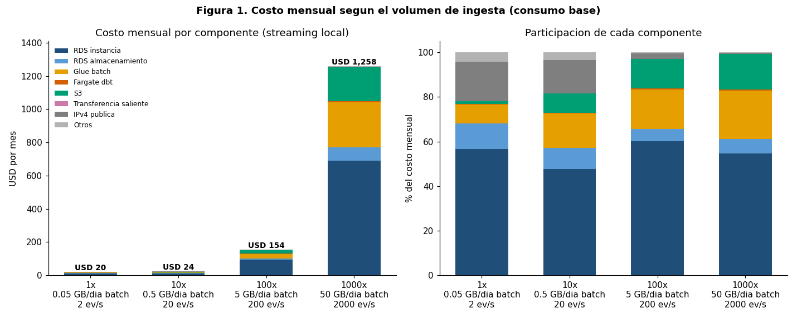
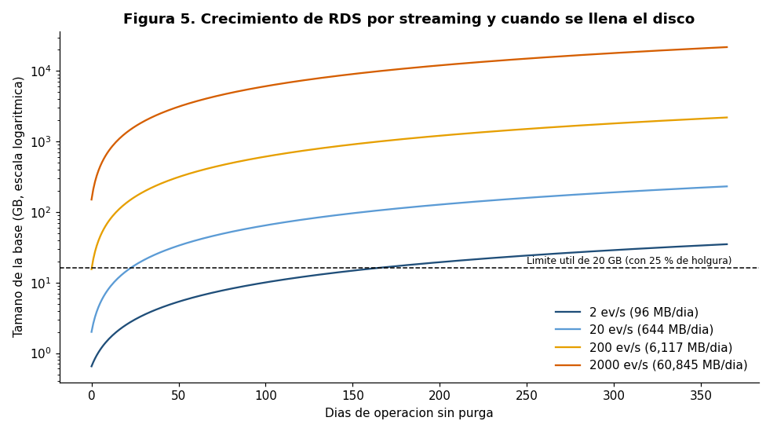
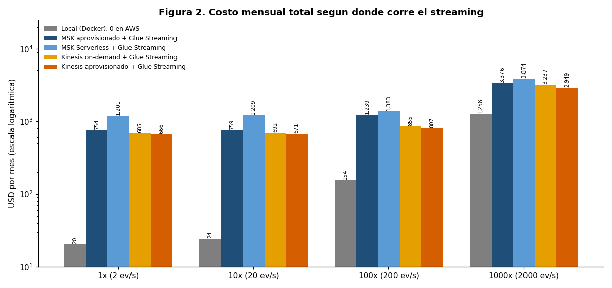
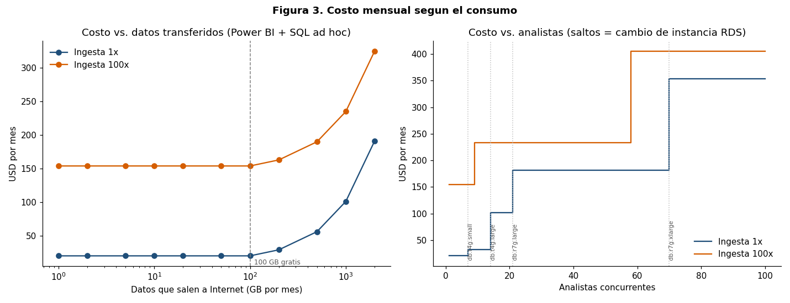
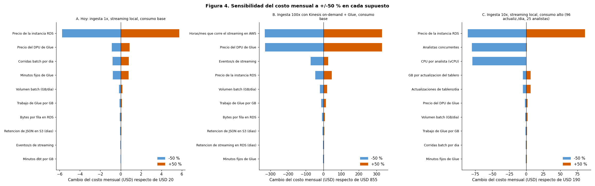

# Análisis de sensibilidad del costo de operación

## 1. Propósito

Estimar cuánto cuesta operar la solución en AWS (región us-east-2) según **la cantidad de datos que ingresan** (batch y streaming) y **la cantidad de datos que se consumen** (tablero de Power BI y consultas SQL), y explicar los supuestos que sostienen cada número. El análisis es reproducible: todos los números salen de `prices.json` (precios reales de AWS) y de las constantes de `cost_model.py`.

| Archivo | Contenido |
| --- | --- |
| `fetch_prices.py` → `prices.json` | Precios on-demand de us-east-2 obtenidos con la AWS Price List API (fecha de consulta: 2026-11-08). |
| `cost_model.py` | Modelo de costo mensual por componente. Genera `tablas.md`, `resultados.json` y `charts/*.png`. |
| `cost_explorer_check.py` → `cost_explorer.json` | Costos reales de los últimos 30 días (Cost Explorer, solo lectura). |
| `aws_cli.py` | Utilidad que ejecuta llamadas de solo lectura de la CLI de AWS (no imprime credenciales). |

Para reproducir: `python fetch_prices.py && python cost_explorer_check.py && python cost_model.py` (requiere `matplotlib`). El modelo por sí solo (`python cost_model.py`) no llama a AWS.

## 2. Supuestos

Unidades: USD por mes de 30 días (720 h). Etiquetas de fuente: **[R]** repositorio/IaC, **[M]** medición del equipo, **[P]** `prices.json` (AWS Price List API), **[A]** supuesto del análisis. Todos son constantes con nombre al inicio de `cost_model.py` y pueden cambiarse.

### 2.1 Precios (on-demand, us-east-2) [P]

| Componente | Precio | Unidad |
| --- | --- | --- |
| RDS PostgreSQL db.t4g.micro / small / medium / large (Single-AZ) | 0.016 / 0.032 / 0.065 / 0.129 | USD/hora |
| RDS db.r7g.large / xlarge / 2xlarge (escalones superiores) | 0.239 / 0.478 / 0.956 | USD/hora |
| RDS almacenamiento gp2 / gp3 | 0.115 / 0.115 | USD/GB-mes |
| Glue (versión 5.0 y streaming) | 0.44 | USD/DPU-hora (mínimo 1 min por corrida) |
| Fargate Linux x86: vCPU / memoria | 0.04048 / 0.004445 | USD/hora y USD/GB-hora |
| S3 Standard / PUT / GET | 0.023 / 0.000005 / 0.0000004 | USD/GB-mes y USD/solicitud |
| Step Functions Standard | 0.000025 | USD/transición |
| Transferencia saliente a Internet | 0.09 (0–10 TB), 0.085, 0.07, 0.05 | USD/GB por tramos (100 GB/mes gratis) |
| CloudWatch: métrica / alarma / dashboard / ingesta de logs | 0.30 / 0.10 / 3.00 / 0.50 | USD/mes, USD/mes, USD/mes, USD/GB |
| Secrets Manager | 0.40 | USD/secreto-mes |
| IPv4 pública | 0.005 | USD/hora |
| ECR | 0.10 | USD/GB-mes |
| MSK: kafka.t3.small / kafka.m7g.large | 0.0456 / 0.204 | USD/broker-hora |
| MSK Serverless: clúster / partición / entrada / salida | 0.75 / 0.0015 / 0.10 / 0.05 | USD/hora, USD/hora, USD/GB, USD/GB |
| Kinesis on-demand: stream / entrada / salida | 0.04 / 0.08 / 0.04 | USD/hora, USD/GB, USD/GB |
| Kinesis aprovisionado: shard / unidad PUT de 25 KB | 0.015 / 0.000000014 | USD/hora, USD/unidad |

No hizo falta ningún precio manual: todos los registros de `prices.json` tienen `"source": "aws-price-list-api"`. Se aplica la capa gratuita **permanente** (100 GB de salida, 4 000 transiciones de Step Functions, 10 alarmas/métricas y 3 dashboards de CloudWatch, 5 GB de logs); `APPLY_FREE_TIER = False` la desactiva.

### 2.2 Ingesta batch

| Supuesto | Valor | Fuente |
| --- | --- | --- |
| Volumen de entrada hoy | 0,05 GB por corrida (JSON de ~51 MB) | [M] |
| Corridas por día | 1 (régimen); el escenario "observado" usa 4,5 en 30 días | [A] / [CE] |
| Transiciones de Step Functions por corrida | 6 | [R] |
| Glue: G.1X × 2 workers, 4 min por corrida hoy | 2 DPU × 4 min | [R][M] |
| Duración de Glue | `3,5 min fijos + 20 DPU-min por GB / workers`; se agregan workers para que la parte variable dure ≤ 15 min (máx. 100) | [A] |
| dbt (Fargate 0,5 vCPU / 1 GB) | `2,0 min fijos + 10 min por GB` (hoy 2,5 min) | [R][M][A] |
| Retención del JSON en S3 | 90 días | [A] |
| Logs por corrida | 25 MB fijos + 5 MB por GB | [A] |
| Secretos 2, alarmas 5, dashboard 1, métricas 4, ECR 0,3 GB | | [R] |

**Por qué lineal.** Se supone que el tiempo de Glue y de dbt crece en forma lineal con los GB de entrada por encima de un tiempo fijo (arranque de Spark, descarga de la imagen, `dbt seed/test`). El fijo se calibra con la corrida de hoy (4 min y 2,5 min con 0,05 GB), de modo que a 0,05 GB el modelo reproduce lo medido. El costo de Glue es `workers × minutos × tarifa`: al agregar workers el tiempo baja, pero el DPU-minuto variable se mantiene, por eso el costo crece casi linealmente con el volumen. En dbt el cómputo real ocurre en RDS (el contenedor solo espera), así que su tiempo no baja agregando vCPU a Fargate: es el cuello de botella real a partir de 100x.

### 2.3 Ingesta streaming

| Supuesto | Valor | Fuente |
| --- | --- | --- |
| Transacciones hoy | 2 por segundo | [M] |
| Filas FX | 1,5 por segundo, fijas (dependen de las monedas, no del volumen) | [M] |
| Bytes por fila en RDS (con índices) | 369 (transacción), 288 (FX) → ≈ 96 MB/día hoy | [M] |
| Retención en RDS | 7 días calientes; el resto se archiva en S3 (Parquet, 20 % del tamaño, 365 días) | [A] |
| Evento en el broker | 600 bytes, retención 3 días, replicación ×3 | [A] |
| MSK aprovisionado | 3 brokers (uno por zona); kafka.t3.small hasta 0,1 MB/s y kafka.m7g.large por encima | [A] |
| Kinesis aprovisionado | shards = máx(MB/s, registros/s ÷ 1 000), mínimo 1 | [P] |
| Consumidor: Glue Streaming | mínimo 2 DPU, 24 × 7; 500 filas/s por DPU | [P][A] |

Hoy el streaming corre en Docker local y su costo en AWS es 0. Las cuatro alternativas AWS (MSK aprovisionado, MSK Serverless, Kinesis on-demand, Kinesis aprovisionado) usan siempre Glue Streaming como consumidor.

### 2.4 Consumo y dimensionamiento de RDS

| Supuesto | Valor |
| --- | --- |
| Consumo base | 8 actualizaciones del tablero por día, 3 analistas concurrentes |
| Datos por actualización | 0,05 GB (Gold agregado, ≈ un archivo de entrada); SQL ad hoc: 0,5 GB/mes por analista |
| Carga de CPU | 1 ms de CPU por fila escrita; 0,02 vCPU promedio por analista; 10 consultas × 3 vCPU-s por actualización; dbt consume 1 vCPU mientras corre |
| Base de datos | 0,5 GB base + 3× el archivo batch (se reemplaza en cada corrida) + streaming de los últimos 7 días |
| Disco | 1,25 × tamaño de la base, mínimo 20 GB (gp2) |

**Regla de cambio de instancia.** Se elige la instancia más barata de la escalera `t4g.micro → small → medium → large → r7g.large → xlarge → 2xlarge` que cumpla las dos condiciones: (1) **memoria**: tamaño de la base ≤ 10 × RAM (1, 2, 4, 8, 16, 32, 64 GB); (2) **CPU**: carga promedio ≤ 70 % de la CPU sostenida de la instancia, que en las `t4g` es la línea base de créditos (micro 0,2 vCPU; small y medium 0,4; large 0,6) y en `r7g` el total (2, 4, 8 vCPU). Las cuatro `t4g` tienen 2 vCPU, por eso `medium` nunca resulta necesaria por CPU. El disco crece sin cambiar de instancia.

## 3. Resultados

Cifras en USD por mes. El detalle completo está en [`tablas.md`](tablas.md) y [`resultados.json`](resultados.json).

### 3.1 Costo por componente según la ingesta (streaming local)

| Componente (USD/mes) | 1x (0,05 GB/día; 2 ev/s) | 10x (0,5 GB/día; 20 ev/s) | 100x (5 GB/día; 200 ev/s) | 1000x (50 GB/día; 2000 ev/s) |
|---|---|---|---|---|
| RDS instancia | 11,52 | 11,52 | 92,88 | 688,32 |
| RDS almacenamiento | 2,30 | 2,30 | 8,28 | 81,53 |
| Glue batch | 1,76 | 3,74 | 27,39 | 271,59 |
| Fargate dbt | 0,03 | 0,09 | 0,64 | 6,20 |
| S3 | 0,26 | 2,09 | 20,38 | 203,27 |
| Transferencia saliente | 0,00 | 0,00 | 0,00 | 0,00 |
| IPv4 pública | 3,61 | 3,62 | 3,73 | 4,86 |
| Otros (Step Functions, Secrets, ECR, CloudWatch, SNS) | 0,84 | 0,84 | 0,85 | 2,47 |
| **Total** | **20,32** | **24,20** | **154,16** | **1 258,24** |

### 3.2 Dónde se rompe la arquitectura barata

| Ingesta | Instancia RDS requerida | Base (GB) | Disco (GB) | Streaming (GB/día) | Días para llenar 20 GB sin purga | Workers Glue | Corrida batch (min) | Excede 60 min |
|---|---|---|---|---|---|---|---|---|
| 1x | db.t4g.micro | 1,3 | 20 | 0,09 | 163 | 2 | 7 | No |
| 10x | db.t4g.micro | 6,4 | 20 | 0,63 | **22** | 2 | 16 | No |
| 100x | db.t4g.large | 57,3 | 72 | 5,97 | ya excede (el batch ocupa el disco) | 7 | **70** | Sí |
| 1000x | db.r7g.2xlarge | 566,4 | 709 | 59,42 | ya excede | 67 | **521** | Sí |

Lectura: a 1x todo cabe en `t4g.micro` y el disco de 20 GB dura unos 5 meses porque hoy no hay purga. A 10x el disco se llena en 22 días: el primer quiebre no es de CPU sino de **almacenamiento** y exige purga o archivo a S3. A 100x cambia la instancia (`t4g.large`), dbt tarda 52 min y la corrida completa excede 60 min; además un único JSON de 5 GB ya no es manejable y debe particionarse en la fuente (Glue no divide un JSON multilínea). A 1000x dbt tarda 8,4 h por corrida: hay que paralelizar los modelos o pasar a un almacén columnar (Redshift/Athena), no solo subir de instancia.

### 3.3 Streaming en AWS (alternativas)

| Arquitectura de streaming | 1x (2 ev/s) | 10x (20 ev/s) | 100x (200 ev/s) | 1000x (2000 ev/s) |
|---|---|---|---|---|
| Local (Docker), 0 en AWS | 20,32 | 24,20 | 154,16 | 1 258,24 |
| MSK aprovisionado + Glue Streaming | 754,08 | 758,77 | 1 239,08 | 3 375,57 |
| MSK Serverless + Glue Streaming | 1 200,59 | 1 208,84 | 1 382,54 | 3 874,42 |
| Kinesis on-demand + Glue Streaming | 684,86 | 692,02 | 854,78 | 3 237,31 |
| Kinesis aprovisionado + Glue Streaming | 666,35 | 670,88 | 807,37 | 2 948,77 |

El piso del streaming en AWS es **Glue Streaming** (2 DPU × 720 h × 0,44 = USD 633,60 al mes) más el broker (Kinesis on-demand USD 28,80; MSK 3 × t3.small USD 98,50; MSK Serverless USD 544,30). Por eso llevar el streaming a AWS suma entre USD 646 y USD 1 180 al mes con el volumen de hoy, sin importar que sean solo 2 eventos por segundo.

### 3.4 Consumo

| Escenario | Actualiz./día | Analistas | GB salida/mes | Instancia RDS (1x) | Total USD (1x) | Instancia RDS (100x) | Total USD (100x) |
|---|---|---|---|---|---|---|---|
| C1 mínimo | 1 | 1 | 2 | db.t4g.micro | 20,32 | db.t4g.large | 154,16 |
| C2 base | 8 | 3 | 14 | db.t4g.micro | 20,32 | db.t4g.large | 154,16 |
| C3 medio | 48 | 10 | 77 | db.t4g.small | 31,84 | db.r7g.large | 233,36 |
| C4 alto | 96 | 25 | 156 | db.r7g.large | 185,97 | db.r7g.large | 238,44 |
| C5 muy alto | 288 | 50 | 457 | db.r7g.large | 213,01 | db.r7g.large | 265,49 |

Umbrales de analistas concurrentes con ingesta 1x (Tabla 5 de `tablas.md`): `t4g.micro` hasta 6, `t4g.small` desde 7, `t4g.large` desde 14, `r7g.large` desde 21, `r7g.xlarge` desde 70 y `r7g.2xlarge` desde 140.

## 4. Análisis de sensibilidad

**Qué mueve el costo.**

- **Hoy (escenario A).** El 86 % de los USD 20,32 es costo fijo de infraestructura encendida (RDS instancia + disco + IPv4 = USD 17,43). El supuesto más influyente es el precio de la instancia RDS (±50 % mueve ±USD 5,76, 28 % del total); el resto, incluidos volumen batch, corridas por día y Glue, mueve menos de USD 1. Duplicar el volumen de datos casi no se nota.
- **Ingesta 100x con streaming en AWS (escenario B).** Dominan las horas de Glue Streaming (precio del DPU y horas encendido: ±USD 331 cada uno, 39 % del total), seguidas de los eventos por segundo (−72/+26) y la instancia RDS (±46).
- **Consumo alto (escenario C).** Dominan los supuestos de dimensionamiento de RDS: precio de la instancia (±86) y carga por analista (−79). Las actualizaciones del tablero y los GB por actualización pesan poco (±5–6).

**Elasticidad de ingesta frente a consumo** (Tabla 8 de `tablas.md`; elasticidad = log₁₀ del factor de costo cuando el factor se multiplica por 10; 1 = costo proporcional, 0 = costo fijo):

| Cambio | Costo antes → después (USD/mes) | Elasticidad |
|---|---|---|
| Ingesta 1x → 10x | 20,32 → 24,20 | 0,08 |
| Ingesta 10x → 100x | 24,20 → 154,16 | 0,80 |
| Ingesta 100x → 1000x | 154,16 → 1 258,24 | 0,91 |
| Consumo ×10 (actualizaciones y analistas), ingesta 1x | 20,32 → 184,03 | 0,96 |
| Consumo ×10, ingesta 100x | 154,16 → 236,51 | 0,19 |
| Solo actualizaciones del tablero ×10, ingesta 1x | 20,32 → 22,26 | 0,04 |

- La ingesta es casi inelástica hasta 10x (el costo es fijo) y pasa a ser casi proporcional desde 100x, cuando se cambia de instancia y Glue y S3 escalan con los GB.
- El consumo es lo contrario: con la ingesta de hoy, subir ×10 los analistas y las actualizaciones multiplica el costo por 9, porque obliga a pasar de `t4g.micro` a `r7g.large` (CPU, no GB transferidos). Con ingesta 100x ya se paga una instancia grande y el mismo aumento solo suma 53 %.
- Lo que cuesta del consumo es la **concurrencia de analistas**, no los GB: los datos de salida solo se cobran sobre los 100 GB gratuitos (USD 32 con 457 GB al mes), mientras que cada escalón de instancia suma entre USD 12 y USD 344 al mes.

## 5. Comparación del modelo con la realidad

Se consultó Cost Explorer (`get-cost-and-usage`, DAILY, `UnblendedCost`, 2026-10-09 a 2026-11-08) con 6 llamadas de solo lectura en total: 3 de la primera versión del script y 3 de la versión final (USD 0,06; la primera agrupaba servicios netos de créditos, que daban 0, y hubo que repetir con el filtro `RECORD_TYPE = Usage`).

| Servicio | Modelo | Cost Explorer | Diferencia |
|---|---|---|---|
| RDS (instancia + disco) | 13,82 | 13,76 | +0,06 |
| IPv4 pública (VPC) | 3,60 | 3,60 | 0,00 |
| Glue | 0,26 | 0,22 | +0,05 |
| Fargate (ECS) | 0,00 | 0,01 | 0,00 |
| S3 | 0,02 | 0,01 | +0,00 |
| Otros (Secrets, ECR, CloudWatch, etc.) | 0,83 | 0,41 | +0,42 |
| **Total** | **18,54** | **18,01** | **+0,52 (+2,9 %)** |

- **Escenario comparado.** El gasto real corresponde a unas 4 a 5 corridas en 30 días (Glue facturó 0,495 DPU-hora ≈ 3,7 corridas de 2 workers × 4 min), no a una por día; por eso la tabla usa 4,5 corridas. Con una corrida diaria el modelo da **USD 20,32 al mes**.
- **Costo fijo.** RDS instancia (720 h × 0,016 = USD 11,52), IPv4 (720 h × 0,005 = USD 3,60) y disco (USD 2,24 reales frente a 2,30 del modelo) coinciden con la factura, y son el 96 % de ella (USD 17,36 de 18,01).
- **Diferencia en "Otros".** El modelo supone 2 secretos (USD 0,80) y Cost Explorer muestra USD 0,39, es decir, un secreto-mes: probablemente uno existió solo parte del período. CloudWatch factura USD 0,00 en la realidad y en el modelo porque las alarmas, el dashboard y las métricas del monitoreo caben en la capa gratuita permanente.
- **Créditos.** El costo neto fue **USD 0,00**: en el mismo período hay créditos por −USD 18,01 que cubren todo el uso (`RECORD_TYPE`: Usage 18,01; Credit −18,01; Tax 0,00). La factura real no revela el costo; el costo bruto sí, y es el que compara el modelo. Cuando los créditos terminen, el equipo pagará unos USD 18 a 20 al mes, por encima del presupuesto de alerta de USD 1.
- **Capas gratuitas de 12 meses.** Si la cuenta es nueva, parte de S3, Glue, CloudWatch y otros servicios puede estar oculta; el modelo aplica solo las gratuidades permanentes.

## 6. Conclusiones

1. **El costo actual es fijo y lo domina RDS.** El modelo da USD 20,32 al mes con una corrida diaria (USD 18,54 con las 4,5 corridas observadas, frente a USD 18,01 reales de Cost Explorer, una diferencia de 3 %). RDS instancia + disco + IPv4 pública son el 86 % del modelo y el 96 % de lo facturado; Glue, Fargate y S3 juntos suman menos de USD 2.
2. **La arquitectura barata resiste hasta cerca de 10x y se rompe por almacenamiento, no por cómputo.** Con 20 ev/s el disco de 20 GB se llena en 22 días sin purga (hoy dura unos 163). A 100x (5 GB/día, 200 ev/s) hace falta `t4g.large`, el costo sube a USD 154 al mes y la corrida batch dura 70 min (dbt, 52 min, es el cuello de botella). A 1000x el costo es USD 1 258 al mes: RDS pesa USD 770 (61 %), Glue USD 272 y S3 USD 203, y la corrida de dbt dura 8,4 h, que obliga a rediseñar y no solo a escalar.
3. **Llevar el streaming a AWS multiplica la factura por 33 a 59 veces con el volumen de hoy.** Sumaría entre USD 646 (Kinesis aprovisionado) y USD 1 180 (MSK Serverless) al mes, de los cuales USD 633,60 son el piso de Glue Streaming (2 DPU, 24 × 7). Ese piso hace que el sobrecosto casi no dependa del volumen hasta 100x (USD 653 con Kinesis aprovisionado) y recién a 1000x suba a USD 1 691–2 616. Mientras el volumen sea bajo, mantener el streaming local o acotar las horas de ejecución (`STREAM_UPTIME`) es la decisión económica.
4. **En consumo importan los analistas concurrentes, no los GB.** La salida a Internet es gratis hasta 100 GB al mes y cuesta USD 32 con 457 GB; en cambio, pasar de 6 a 7 analistas obliga a `t4g.small` (+USD 11,52 al mes) y de 20 a 21 a `r7g.large` (USD 172 al mes de instancia, frente a USD 11,52 de `t4g.micro`).

### Límites del análisis

- Las duraciones por GB (Glue 20 DPU-min/GB; dbt 10 min/GB) y la carga de CPU por fila y por analista son supuestos con un solo punto medido (0,05 GB); medir una corrida con 0,5 GB los validaría o corregiría. Las conclusiones cualitativas (costo fijo hasta ~10x, quiebre por disco, piso de Glue Streaming) no dependen de ellos, como muestra la Figura 4.
- No se modelan Multi-AZ, réplicas de lectura, respaldos adicionales, IOPS aprovisionados, tráfico entre zonas ni impuestos.
- Los precios son on-demand a la fecha de consulta; descuentos (Savings Plans, instancias reservadas) reducirían RDS y Glue.
