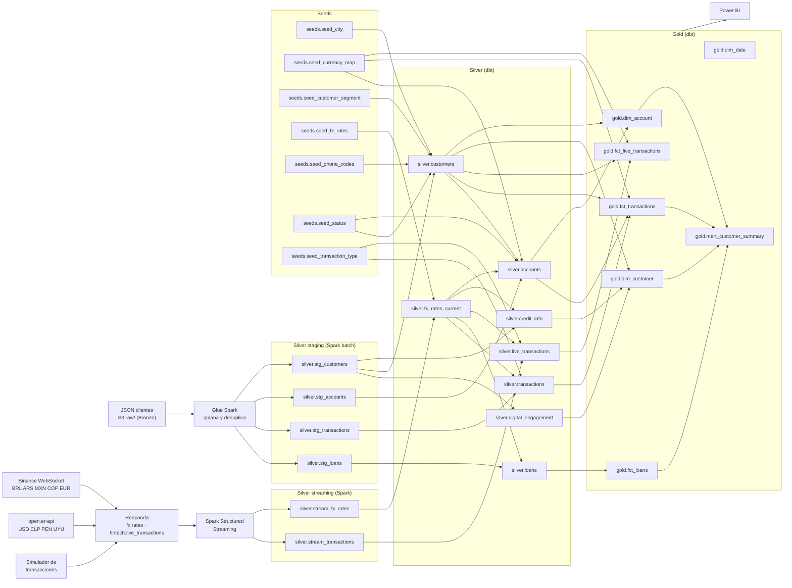

# Linaje de datos

Del dato crudo al reporte. El tramo antes de dbt (S3 → Glue y fuentes → Redpanda → Spark) es fijo; cada flecha entre tablas sale de las dependencias reales de dbt (`ref` y `source`, incluidas las que usan macros como `to_usd` → `fx_rates_current`), así que el diagrama cambia solo cuando cambian los modelos. Se regenera con `build_governance_docs.py`.

El linaje a nivel de columna y el SQL de cada modelo están en el catálogo de dbt: abre `catalog.html` en el navegador y usa el botón del grafo de linaje (abajo a la derecha).

## Cómo leerlo

- **Batch:** un JSON en `raw/` dispara Glue, que escribe `silver.stg_*`. dbt limpia esas tablas en Silver y construye la estrella en Gold.
- **Streaming:** Binance, la API diaria y el simulador publican en Redpanda. Spark cruza cada transacción con su tasa y escribe `silver.stream_*`.
- **Donde se juntan:** `fx_rates_current` toma la última tasa del stream (o el seed si no hay ticks recientes), y todos los montos en USD del batch pasan por ella vía `to_usd`.
- **Seeds:** tablas de referencia versionadas en el repo (ciudades, estados, tipos, prefijos, monedas, tasas de respaldo).
