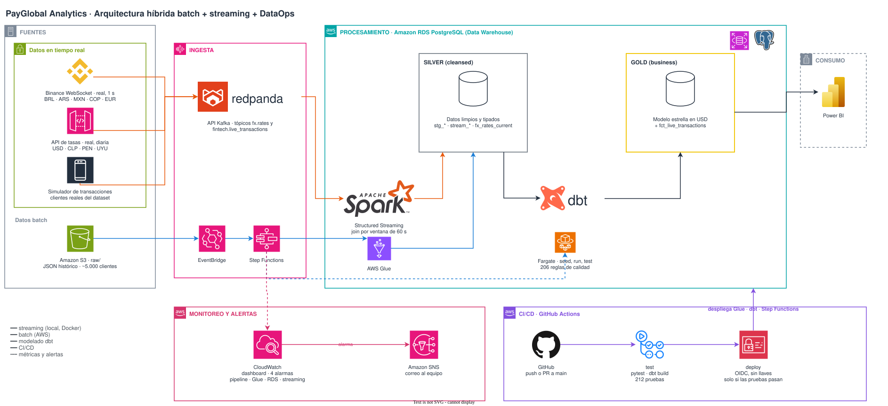
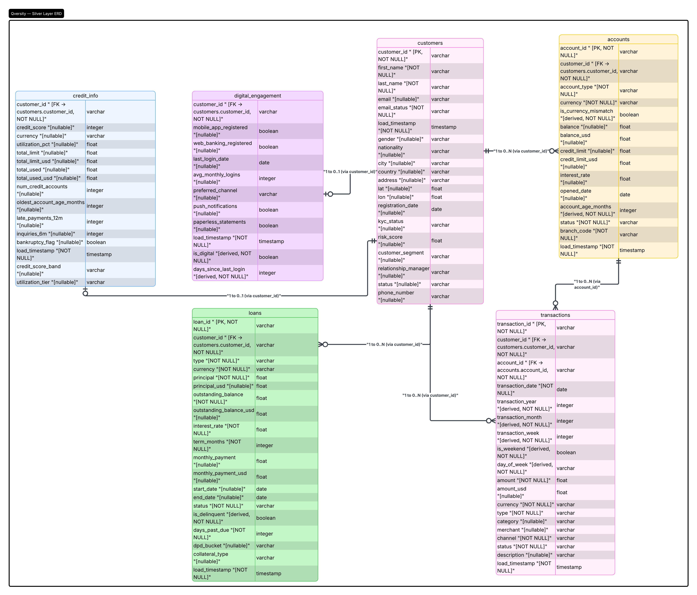
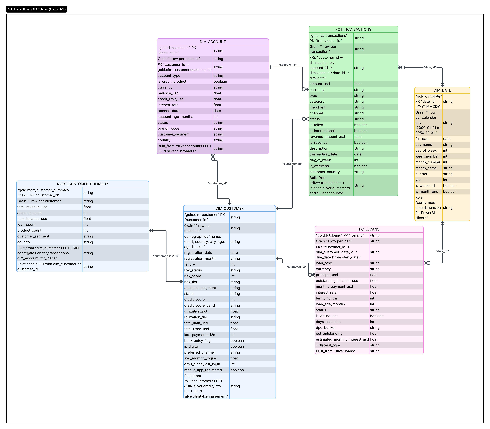

# Payload Analytics: plataforma de datos híbrida para una fintech de LATAM

**Repositorio:** https://github.com/niosto/payload-analytics

**Integrantes:** Nicolás Ospina, Samuel Deossa, Nicolás Saldarriaga, Samuel Henao · **Curso:** SI4002, Sprint Final · **Fecha de entrega:** 9 de noviembre de 2026

> **Estado del borrador (esta nota se borra antes de generar el PDF).**
> Formato de entrega: máximo 6 páginas, Times New Roman 12, con el enlace al repositorio. Cada sección indica su presupuesto de páginas y la lista de figuras con su ruta.
> **Pendientes que solo el equipo puede llenar:** las marcas `TODO` del texto: duración de `test` y de `deploy`, capturas de Actions y del correo de alarma, PNG del diagrama de arquitectura, capturas del dashboard contra la RDS, y las cifras de la demo medidas en los ensayos.
> **Extensión:** con todas las figuras listadas el texto supera las 6 páginas. Al final hay una sección "Cómo recortar a 6 páginas" con el orden en que conviene quitar figuras.

---

## 1. Caso de negocio

*Presupuesto: 0,5 página. Sin figuras.*

Payload Analytics es una fintech que opera en siete mercados de América Latina y mueve dinero en nueve monedas (BRL, ARS, MXN, COP, EUR, USD, CLP, PEN y UYU). Tiene tres problemas que ninguna herramienta por separado resuelve:

1. **Los datos llegan sucios.** Los clientes, cuentas, transacciones y préstamos llegan en un archivo JSON con correos inválidos, montos con símbolos y separadores mezclados, fechas en cuatro formatos y etiquetas en español con errores. Hay que limpiarlos sin perder filas.
2. **Las cifras no se pueden comparar.** Un monto en pesos colombianos no se compara con uno en reales sin una tasa de cambio. Para reportar en USD hace falta una tasa vigente, no una tabla fija.
3. **Hay dos velocidades de datos.** El archivo batch de unos 5.000 clientes llega una vez; las transacciones y las tasas llegan cada segundo. Los equipos de negocio necesitan verlos juntos.

La solución es una sola base PostgreSQL donde el batch y el streaming se encuentran, con cada monto convertido a USD con la tasa en vivo, reglas de calidad que corren en cada ejecución y un dashboard para cuatro tipos de usuario. Dos restricciones guiaron las decisiones: el objetivo de latencia de las tasas (menos de 5 segundos) y un presupuesto de alerta de **USD 1 al mes** en AWS. Los datos son sintéticos: las transacciones en vivo se simulan sobre clientes y cuentas del dataset, y las tasas sí son reales.

## 2. Arquitectura y modelo de datos

*Presupuesto: 1,5 páginas.*

**Figuras y capturas de esta sección**

| # | Figura | Ruta | Estado |
| --- | --- | --- | --- |
| 1 | Arquitectura híbrida con CI/CD y monitoreo | `imgs/architecture.drawio.svg` | Hay que exportarlo a PNG (no se edita el SVG): `imgs/architecture.png` · **TODO humano** |
| 2 | Diagrama del esquema Silver | `imgs/silver_diagram.jpeg` | Existe |
| 3 | Diagrama del esquema Gold (estrella) | `imgs/gold_diagram.jpeg` | Existe |

**Visión general.** El **batch** vive en AWS: un archivo JSON en S3 (`raw/`) dispara, por EventBridge, una máquina de estados de Step Functions que ejecuta un job de Glue (Spark aplana y deduplica) y una tarea de Fargate (dbt limpia y modela), y luego mueve el archivo a `processed/` o, si algo falla, a `failed/` con un aviso por SNS. El **streaming** corre en Docker local: dos productores de tasas y un simulador de transacciones escriben en Redpanda (compatible con Kafka), y Spark Structured Streaming une cada transacción con la tasa de su moneda del minuto anterior y escribe en la misma RDS. dbt convierte todo a USD con la tasa vigente, y ahí se encuentran las dos velocidades.

**Modelo de cada base**

| Almacén | Modelo | Contenido |
| --- | --- | --- |
| **S3** (lago) | Carpetas por estado | `raw/` entrada, `processed/` archivo archivado, `failed/` archivos que no terminaron. El archivo original nunca se borra. |
| **Redpanda** (Bronze del streaming) | Dos tópicos de 3 particiones | `fx.rates`, con clave `currency`: `event_id`, `event_time`, `currency`, `base`, `units_per_usd`, `usd_per_unit`, `provider`, `provider_updated_at`. `fintech.live_transactions`, con clave `customer_id`: `event_id`, `event_time`, `source`, `customer_id`, `transaction_id` (prefijo `LTX-`), `account_id`, `date`, `currency` y los campos de una transacción real de la misma moneda. Todo en texto, igual al contrato de `silver.stg_transactions`. |
| **RDS PostgreSQL**, Silver | Medallón | `stg_*` (lo que escribe Spark) y `stream_*` (lo que escribe el streaming, upsert por `transaction_id` y `event_id`), más los modelos limpios de dbt: montos tipados, fechas parseadas, marcas de correo inválido y de moneda distinta a la del país, y `fx_rates_current`. |
| **RDS PostgreSQL**, Gold | Estrella para reporte | Dimensiones `dim_customer`, `dim_account`, `dim_date` y `dim_fx_rate_current`; hechos `fct_transactions`, `fct_loans` y `fct_live_transactions` (incremental); y `mart_customer_summary`. |

El proyecto dbt tiene 16 modelos, 7 seeds y 212 pruebas. Los seeds son las tablas de referencia: etiquetas en español (estado, tipo de transacción, segmento), ciudades, moneda por país, prefijos telefónicos y tasas de respaldo.

**Decisiones de diseño con justificación**

| Decisión | Justificación |
| --- | --- |
| Híbrido: batch en AWS, streaming en Docker local | Un Kafka administrado cuesta USD 70–500 al mes y Kinesis más un job de Glue Streaming cerca de USD 1 por hora, frente a un presupuesto de USD 1 al mes. Ambos lados escriben en la misma RDS, así que dbt no distingue de dónde viene una fila. |
| RDS pública y sin NAT Gateway | El NAT Gateway se cobra por hora. La tarea de dbt corre en las subredes públicas de la VPC por defecto con IP pública, y la base se alcanza con `sslmode=require` y contraseña en Secrets Manager. El precio es un punto de entrada público (ver limitaciones). |
| Glue sin Glue Connection | Glue usa la red administrada de AWS y llega al endpoint público de la RDS, sin conexión a la VPC. |
| Spark solo aplana; dbt limpia | Las reglas de limpieza son modelos SQL con pruebas, no código dentro del job de Glue. |
| `LEFT JOIN` en el streaming | Si la fuente de tasas se cae, la transacción se escribe igual (sin tasa) cuando pasa la marca de agua de 2 minutos, y dbt la convierte con `fx_rates_current`. |
| `fx_rates_current` con `LATERAL` e índice de expresión | `DISTINCT ON` leía toda la ventana de 48 h e ignoraba el índice: 1.593 ms. Un `LATERAL ... LIMIT 1` por moneda lo usa: 0,19 ms. |
| OIDC de GitHub en lugar de llaves de AWS | GitHub no guarda ningún secreto de AWS: el rol solo lo asume la rama `main` de este repositorio. |

**Optimización de la base.** Medidas con `EXPLAIN (ANALYZE, BUFFERS)` sobre un volumen de prueba de 2 millones de ticks y 1 millón de transacciones en vivo: última tasa FX por moneda, de 1.593 ms a 0,19 ms; filtro incremental de `fct_live_transactions`, de 712 ms a 0,37 ms; ingresos por país y mes (dashboard), de 1.827 ms a 49 ms. Un cuarto experimento (BRIN) no se aplicó. Detalle en `docs/optimizations/`.

## 3. DataOps y consumo

*Presupuesto: 1,5 páginas.*

**Figuras y capturas de esta sección**

| # | Figura | Ruta | Estado |
| --- | --- | --- | --- |
| 4 | Ejecución de Actions con `test` y `deploy` en verde, con duraciones | Captura de Actions | **TODO humano** |
| 5 | Resumen del job `deploy` (imagen = SHA del commit) | Captura de Actions | **TODO humano** |
| 6 | Dashboard de CloudWatch: ejecuciones de Step Functions | `docs/monitoring/stepfunctions-executions.png` | Existe |
| 7 | Dashboard de CloudWatch: latencia y lag del streaming | `docs/monitoring/streaming-latency-lag.png` | Existe |
| 8 | Correo de alarma (`ALARM` y luego `OK`) | Captura del correo | **TODO humano** |
| 9 | Dashboard de Power BI, 4 páginas | `powerbi/screenshots/01-resumen.png`, `02-clientes-riesgo.png`, `03-tiempo-real.png`, `04-gobierno.png` | Existen. **TODO humano:** retomarlas contra la RDS |

Otras capturas disponibles si hay espacio: `docs/monitoring/rds-cpu-storage.png` y `docs/monitoring/streaming-throughput.png`.

**CI/CD.** Un flujo de GitHub Actions (`.github/workflows/ci.yml`) con dos trabajos. **`test`** corre en cada pull request y en cada push a `main`: 33 pruebas de `pytest` (productores y transformaciones de Spark) y una prueba de integración de dbt sobre un PostgreSQL temporal, con las migraciones reales, el `build_silver_frames` real sobre 300 clientes y la secuencia completa de dbt: 7 seeds, 16 modelos y **212 pruebas, todas en verde** (en una segunda pasada corre también la rama incremental). Ninguna prueba se omite ni se relaja. **`deploy`** corre solo en `main` y solo si `test` pasó: asume por OIDC el rol de despliegue, aplica la migración, sube la imagen de dbt etiquetada con el SHA del commit y despliega la tarea y la máquina de estados. Los despliegues nunca se solapan. Duraciones medidas: `test` **TODO medir**; `deploy` **TODO medir**.

El rol solo puede cambiar los stacks `payload-analytics-backend-*`. Su seguridad depende de que `main` esté protegida (PR obligatorio y check `test` requerido); es el control principal y está documentado en `docs/cicd.md`.

**Monitoreo y alertas.** Un stack de Serverless crea un dashboard de CloudWatch (`payload-analytics`) y cuatro alarmas que avisan por correo al tema SNS de alertas: pipeline fallido, poco espacio libre en la RDS (menos de 5 GB), CPU alta (más de 80 % por 10 minutos) y lag del streaming (más de 60 s durante 3 minutos). El job de streaming publica sus propias métricas una vez por minuto: filas escritas, latencia p95 y lag. La alarma de prueba se fuerza con `aws cloudwatch set-alarm-state`, y el correo llega en menos de un minuto.

**Consumo: dashboard en Power BI.** Cuatro páginas sobre Gold, con 42 medidas, para cuatro tipos de usuario.

| Página | Quién la usa | Qué decide con ella |
| --- | --- | --- |
| Resumen ejecutivo | Dirección comercial | Qué segmentos y países impulsar, y si el ingreso, el volumen y el ticket promedio crecen. |
| Clientes y riesgo crediticio | Riesgo de crédito | Dónde ajustar límites o iniciar cobranza: bandas, segmentos, países y productos con más mora. |
| Operación en tiempo real | Operaciones y tesorería | Si el flujo en vivo es sano, qué tan fresco está y qué tasa se aplica a cada moneda. |
| Calidad y gobierno del dato | Responsable de datos | Si las cifras son confiables antes de compartirlas y qué fuente corregir primero. |

**Gobernanza.** `docs/governance/` contiene el diccionario de datos (383 columnas, cada una con clase de sensibilidad), el catálogo de dbt en un solo HTML, el linaje de punta a punta, las 212 reglas de calidad y la matriz RACI.

## 4. Costo y escalabilidad

*Presupuesto: 1 página.*

**Figuras de esta sección** (rutas en `docs/cost/charts/`; elegir dos o tres por espacio)

| # | Figura | Ruta |
| --- | --- | --- |
| 10 | Costo mensual por componente | `docs/cost/charts/fig1_costo_por_componente.png` |
| 11 | Costo según el consumo | `docs/cost/charts/fig3_costo_vs_consumo.png` |
| 12 | Crecimiento del disco por streaming | `docs/cost/charts/fig5_crecimiento_disco.png` |
| 13 | Sensibilidad (tornado) | `docs/cost/charts/fig4_tornado.png` |
| 14 | Streaming en AWS frente a local | `docs/cost/charts/fig2_streaming_en_aws.png` |

El modelo de `docs/cost/` calcula la factura mensual con precios reales de la AWS Price List API (us-east-2, on-demand, consultados el 2026-11-08) contra los datos que entran y los que se consumen. **Supuestos principales:** mes de 30 días (720 h); una corrida batch al día; hoy 0,05 GB por archivo y 2 transacciones por segundo, más 1,5 filas FX por segundo; RDS en una sola zona de disponibilidad; el streaming corre en Docker local y su costo en AWS es cero; consumo base de 8 actualizaciones del dashboard al día y 3 analistas concurrentes. Cada supuesto está etiquetado en el modelo como medición del equipo, del repositorio, de precios o supuesto del análisis.

| | 1× (0,05 GB/día; 2 ev/s) | 10× (0,5 GB/día; 20 ev/s) | 100× (5 GB/día; 200 ev/s) |
| --- | --- | --- | --- |
| Instancia RDS | `db.t4g.micro` | `db.t4g.micro` | `db.t4g.large` |
| **Costo mensual (USD)** | **20,32** | **24,20** | **154,16** |
| Días para llenar los 20 GB de disco sin purga | 163 | 22 | ya excede |
| Duración de una corrida batch | 7 min | 16 min | 70 min |

**Validación contra la factura.** Con las 4,5 corridas por mes realmente observadas, el modelo da **USD 18,54** frente a **USD 18,01** facturados en Cost Explorer (diferencia de 3 %). RDS (instancia, disco e IPv4 pública) es el 96 % de lo facturado, de modo que el costo es casi fijo. El costo neto fue USD 0,00 porque los créditos de la cuenta cubren todo el uso; cuando terminen, el equipo pagaría unos USD 18 a 20 al mes, por encima del presupuesto de alerta de USD 1.

**Qué se rompe primero.** La arquitectura barata resiste hasta cerca de 10× y se rompe por **almacenamiento, no por cómputo**: a 20 eventos por segundo el disco de 20 GB se llena en 22 días sin purga. A 100× hace falta una `db.t4g.large` y la corrida batch (70 min) excede los 60 minutos de la ventana, con dbt como cuello de botella (52 min). **Llevar el streaming a AWS** sumaría entre USD 646 (Kinesis aprovisionado) y USD 1.180 (MSK Serverless) al mes con el volumen de hoy; por eso corre local. En consumo importan los analistas concurrentes, no los gigabytes: pasar de 6 a 7 analistas obliga a una `db.t4g.small`.

*Límites del análisis:* las duraciones por GB y la carga de CPU por analista son supuestos con un solo punto medido (0,05 GB); no se modelan Multi-AZ, réplicas, IOPS aprovisionados ni descuentos por reserva.

## 5. Guía de despliegue desde cero

*Presupuesto: 0,75 página. Sin figuras.*

**Requisitos:** Docker Desktop, una cuenta de AWS con permisos para S3, RDS, ECR, Glue, ECS, Step Functions, SNS e IAM, y una llave de Serverless Framework. Nada más se instala en el equipo: Serverless, la CLI de AWS y Docker corren en los contenedores de desarrollo. La guía completa con todos los comandos está en el `README.md` del repositorio.

1. **Variables de entorno.** Crear `.envs/aws.env`, `.envs/sls.env` y los `config.env` de `infrastructure/` y `backend/` con `DEVELOPER` (en minúsculas), `DEFAULT_VPC_ID`, `DEFAULT_VPC_SUBNET_IDS` y `ALERTS_EMAIL`.
2. **Infraestructura.** Levantar el contenedor de infraestructura y desplegar, en este orden: `storage`, `rds`, `registry`, `alerts` y, después, `monitoring` y `cicd` (este último con credenciales de administrador). Confirmar la suscripción de correo de SNS. Luego guardar la llave de Serverless con `aws secretsmanager put-secret-value --secret-id /payload-analytics-cicd/ServerlessAccessKey`.
3. **Backend.** Levantar el contenedor de backend y ejecutar `database/rds/migrate.sh`, `serverless/spark/deploy.sh`, `serverless/dbt/deploy.sh` y, al final, `serverless deploy` en `serverless/orchestration`, que depende de todo lo anterior.
4. **Pipeline batch.** Copiar `data/raw/fintech_banking_dataset.json` a `raw/` del bucket del lago. EventBridge dispara Step Functions; al terminar el archivo queda en `processed/`.
5. **Conexión a la RDS.** Con cualquier cliente PostgreSQL, usando el endpoint de SSM y la contraseña de Secrets Manager. Los esquemas son `silver`, `seeds` y `gold`.
6. **Streaming (local).** Crear las tablas de streaming con la migración y levantar `docker compose` en `streaming/`: Redpanda, productores de tasas, simulador de transacciones y el job de Spark.

**Si se despliega en otra cuenta de AWS**, hay valores fijos en el repositorio que se cambian: en `.github/workflows/ci.yml` (`AWS_DEPLOY_ROLE_ARN`, `DEVELOPER`, `DEFAULT_VPC_ID` y `DEFAULT_VPC_SUBNET_IDS`) y el repositorio de confianza en `infrastructure/serverless/cicd/serverless.yml`. Después del primer merge hay que proteger `main`. Cada merge a `main` dispara un despliegue completo, así que los cambios se agrupan en un solo PR.

## 6. Resultados y limitaciones

*Presupuesto: 0,75 página. Sin figuras.*

**Resultados**

- El flujo funciona de punta a punta: un archivo en S3 llega a Gold sin intervención y las transacciones en vivo llegan a la RDS junto con su tasa.
- **212 pruebas de dbt** pasan en cada ejecución del pipeline y en la integración de CI, más 33 pruebas unitarias.
- La latencia de las tasas cumple el objetivo de menos de 5 segundos: cada micro-batch tarda unos 2 s en el join y unos 0,3 s en escribir en la RDS. p95 medido en la demo: **TODO medir**.
- Las optimizaciones bajan consultas reales del pipeline de segundos a milisegundos (hasta ~8.500× en la tasa FX).
- El costo operativo modelado (USD 18,54 al mes) está a 3 % del facturado (USD 18,01).
- Un cambio fusionado en `main` prueba y despliega solo; las cuatro alarmas avisan por correo.
- Tiempos de la demo en ensayo: `test` **TODO medir**, `deploy` **TODO medir**, batch completo **TODO medir** (el modelo de costo supone 7 min).

**Limitaciones**

- **Datos personales sin enmascarar:** la PII directa (nombre, correo, teléfono, dirección y coordenadas) llega sin enmascarar hasta `gold.dim_customer`. El diccionario la clasifica, pero el plan de aplicar hash SHA-256 y vistas con acceso por rol quedó pendiente.
- **RDS pública:** sin NAT Gateway, la base tiene un punto de entrada abierto a Internet protegido por contraseña y SSL.
- **El streaming corre solo en local:** si el portátil se apaga, no hay captura en vivo. Llevarlo a AWS multiplicaría el costo por 33 a 59 veces.
- **La alarma de lag no avisa si el job se cae por completo,** porque entonces no publica métricas; se ve en el dashboard, en el panel de filas escritas vacío.
- **El rol de despliegue se limita por prefijo de nombre** y su seguridad depende de la protección de `main`: quien pueda fusionar en `main` puede cambiar lo que se despliega.
- **Datos sintéticos:** las transacciones en vivo se simulan, y el ARS de mercado es el dólar cripto (unos 1.615 por USD el 2026-10-15), no el oficial.
- **El batch no es incremental:** cada archivo nuevo reemplaza por completo `silver.stg_*`.
- **El dashboard se construyó sobre una base local** antes de pasar a la RDS; las cifras de las capturas actuales son de esa base. El `.pbix` guarda una copia de los datos y hay que refrescarlo contra la RDS.
- **Qué no se verificó:** el modelo de costo asume un solo punto de medición (0,05 GB) para las duraciones por GB.

---

## Cómo recortar a 6 páginas

*(Esta sección es para el equipo; se borra antes del PDF.)*

Con Times New Roman 12, una página admite unas 500 palabras de texto corrido o menos si hay tablas. Este borrador tiene unas 3.100 palabras y 14 figuras, así que no cabe en 6 páginas sin recortes. Orden sugerido:

1. **Reducir las capturas del dashboard** de cuatro a una cuadrícula de 2 × 2 en una sola figura, y hacer lo mismo con las dos imágenes de CloudWatch.
2. **Costo:** dejar solo las figuras 10 y 12 (`fig1` y `fig5`).
3. **Arquitectura:** dejar la figura 1 y una sola de las dos de Silver y Gold, o ponerlas lado a lado en la misma fila.
4. **Tablas:** convertir la tabla de decisiones en cinco filas y quitar las filas de modelo de datos que repitan los diagramas.
5. **Despliegue:** referirse al `README.md` para los comandos y dejar solo los seis pasos en una línea cada uno.

Las capturas de Actions y del correo de alarma (figuras 4, 5 y 8) son las que más pesan en la rúbrica de DataOps; conviene conservarlas aunque se quite otra figura.
